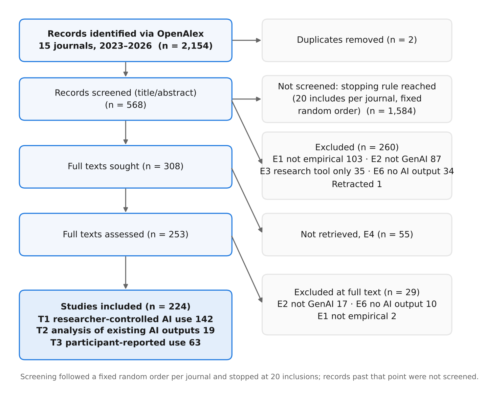
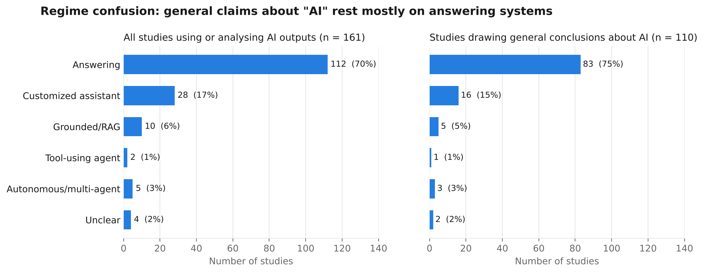
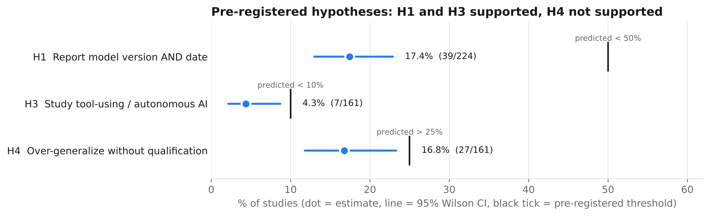
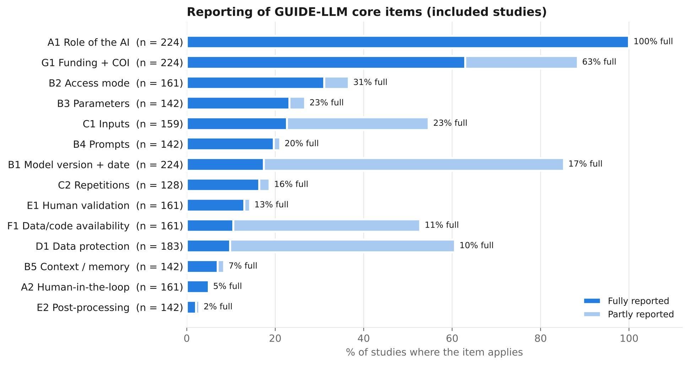
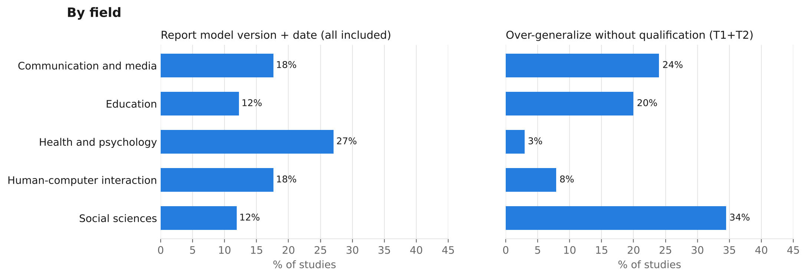

# Which AI? Regime Confusion and Reporting Gaps in Research on Generative AI in Society

Data, code and codebook for a pre-registered, cross-disciplinary audit of 224 empirical studies of generative AI. The studies were published 2023–2026 in 15 journals spanning communication, education, health and psychology, human–computer interaction, and the social sciences.

**Authors**
- Samson Quaye, Center for Cybersecurity and Forensic Education (C2SAFE), Illinois Institute of Technology, Chicago, IL, USA
- Calvin Nobles, University of Maryland Global Campus, USA
- Abdul Hadi Khan, School of Computer Information Sciences, University of the Cumberlands, KY, USA
- Ahmed Ben Ayed, School of Engineering & Technology, National University, San Diego, CA, USA
**Status:** abstract submitted to IOCSS 2027; full paper in preparation.

## Key results

| | Result |
|---|---|
| Studies that used or analysed AI outputs (T1+T2) and examined only answering systems | 112/161 (70%) |
| Studies that examined tool-using or autonomous agents | 7/161 (4.3%) |
| Studies that drew general conclusions about AI and based them only on answering systems | 83/110 (75%) |
| Studies that stated findings may depend on the model or version | 54/161 (34%) |
| **H1** Studies reporting both the model version and when it was used | 39/224 (17.4%; 95% CI 13.0–22.9), supported |
| **H2** Overall reporting completeness differs by field | Kruskal–Wallis p = .35, not supported (funding/COI disclosure does differ, Holm p = .001) |
| **H3** Fewer than 10% study tool-using/autonomous AI | 7/161 (4.3%; 2.1–8.7), supported |
| **H4** More than 25% over-generalize without qualification | 27/161 (16.8%; 11.8–23.3), not supported (significantly below 25%) |

All tables are in `results/which_ai_results_final.xlsx`.

## Figures

**Study selection (PRISMA)**



**Regime confusion**



**Pre-registered hypotheses**



**Reporting of each GUIDE-LLM item**



**By field**



Every figure is regenerated from the data by `scripts/06_analysis/make_figures.py`. SVG versions are in `figures/`.

## Reproduce the results

```bash
pip install -r requirements.txt
python scripts/06_analysis/analysis_final.py      # hypotheses, field tests, regression, sensitivity
python scripts/06_analysis/regime_confusion.py    # regime breakdown behind the regime-confusion finding
python scripts/06_analysis/make_figures.py        # all figures
```

Both scripts read only files in `data/` and need no PDFs.

## Repository structure

```
codebook/            codebook v1.0, plus the documented changes in v1.1 and v1.2
data/screening/      screening order, all 568 title/abstract decisions, full-text list (308), PRISMA counts
data/coding/         final coding of 253 assessed full texts, with verbatim evidence; X6 three-judgment file; re-check and adjudication logs
data/reliability/    51-paper double-coding sample, second-coder (GPT) output, quote verification, kappa
results/             final results workbook
scripts/01_search    OpenAlex retrieval
scripts/02_fulltext  open-access full-text retrieval
scripts/03_coding    regex first pass, per-batch coding decisions, quote verification and merge
scripts/04_final_pass  item re-checks (B1, G1, X6, E1) and adjudication
scripts/05_reliability inter-coder agreement
scripts/06_analysis  pre-specified analyses and figures
figures/             PRISMA diagram and result charts (PNG + SVG)
scripts/helpers      search utilities used during coding
```

## Method in brief

- **Sampling.** Records for each journal were screened in a fixed random order. Screening stopped at 20 inclusions per journal, so records after that point were not screened.
- **Exclusion codes.** E1 not empirical; E2 not generative AI; E3 generative AI used only as a research tool; E4 full text inaccessible; E6 no real AI output.
- **Study types.** T1 researcher-controlled AI use; T2 analysis of existing AI outputs; T3 participant-reported use. For T3 studies, only items A1, B1, D1 and G1 apply.
- **Items.** The 14 core GUIDE-LLM items (A1, A2, B1–B5, C1–C2, D1, E1–E2, F1, G1) are coded R (reported), P (partly), N (not reported) or NA (not applicable). The agentic extension adds X1 regime, X2–X5 (coded only for tool-using/autonomous regimes) and X6 over-generalization. R records the authors' own LLM use.
- **Evidence.** Every R or P code, and every exclusion, carries a verbatim quote. A script checks that each quote is a substring of the article's full text.
- **X6, final rule (v1.2).** X6 = yes when a study makes a general claim about AI AND its limitations give no qualification about the model or setup used.

The codes describe what is reported in each article's text. They are not judgements of the quality of the research.

## AI-assisted coding (disclosure)

- **First pass.** Claude (Anthropic) produced the first-pass coding, supported by regex scripts. All of it was run through the quote-verification scripts.
- **Double coding.** A 20% stratified subsample (51 full texts) was coded independently by a second LLM, OpenAI GPT (model, version, run dates and settings: *to be added*), and by the first author.
- **Adjudication.** All final disagreements were adjudicated by the first author.
- **Changes to the protocol.** These are documented in `codebook/codebook_changes_v1.1_v1.2.md` and in the OSF deviations log.

## What is not included

- **No full texts and no PDFs.** Articles can be obtained via the DOIs in `data/screening/fulltext_list.csv`. To rerun the coding scripts, place PDFs in `fulltexts/` and text extracts in `ft_txt/` (both are git-ignored).
- **No publisher abstracts.**
- **No personal or library-request files.**

## Licence

Code: MIT (`LICENSE`). Data and codebook: CC BY 4.0 (`LICENSE-DATA.md`).

## Citation

Quaye, S., Nobles, C., Khan, A. H., & Ben Ayed, A. (2026). *Which AI? Regime confusion and reporting gaps in research on generative AI in society* [Data and code]. GitHub.
